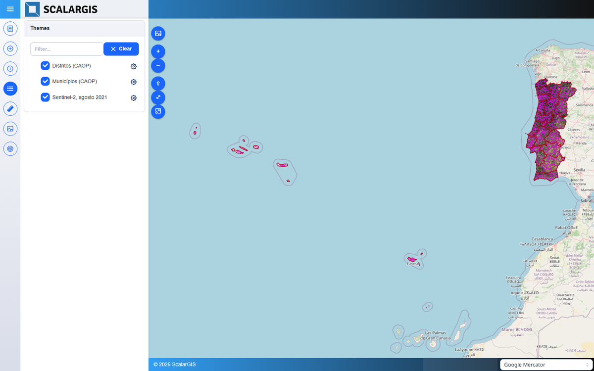

# ScalarGIS stack

Run ScalarGIS on one machine with Docker: the map viewer, the backoffice, a PostGIS database, and GeoServer.

[Website](https://scalargis.com) · [Docs](https://docs.scalargis.com) · [Demo](https://demo.scalargis.com)



## What you need

- A machine with [Docker](https://docs.docker.com/get-docker/) and [git](https://git-scm.com/downloads).
- 4 GB of free RAM and port 80 free.
- The first build takes some minutes.

## Install

```sh
git clone --recurse-submodules https://github.com/scalargis/scalargis-stack.git
cd scalargis-stack
./setup.sh                       # on Windows: .\setup.ps1
docker compose up -d --build
```

Open `http://localhost/mapa/demo`. Log in to the backoffice with `admin` / `admin` and change the password at once.

| URL | What |
|---|---|
| `http://localhost/mapa/demo` | The demo map viewer |
| `http://localhost/backoffice` | The backoffice: viewers, layers, users, prints |
| `http://localhost/geoserver` | GeoServer. The login is in `.env` |

## Details

`setup.sh` gets the `scalargis-server` and `scalargis-client` submodules, copies `.env.example` to `.env`, and writes
a random database password, secret key, password salt, and GeoServer password. Set a different port with `HTTP_PORT`
in `.env`.

The stack builds the server image and the app image on your machine. It pulls no ScalarGIS image from a registry.

| Service | Role |
|---|---|
| `db` | PostGIS. The first start makes the `scalargis` schema, the `admin` user, and the demo viewer |
| `scalargis` | The API, the viewer, and the backoffice |
| `worker` | The background jobs |
| `geoserver` | Your own map services |
| `proxy` | nginx on port 80 |

## Update

```sh
git pull
git submodule update --init
docker compose up -d --build
```

## Stop and remove

```sh
docker compose down        # keep the data
docker compose down -v     # remove the data too
```

## Production

This stack has no TLS and one size. For a domain, certificates, sizing, and backups, see the
[production stack](https://docs.scalargis.com/deployment/prod-stack/) and the
[sizing](https://docs.scalargis.com/deployment/sizing/) pages.
